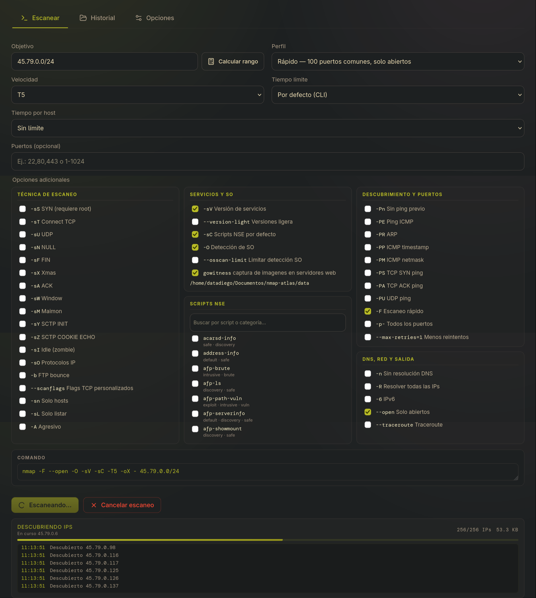

# nmap atlas

Aplicación para lanzar escaneos con Nmap y explorarlos como grafo, árbol, lista y raw. Realiza capturas de servidores http automaticamente con el módulo de `gowitness` y explora todos los descubrimientos cómodamente.



## Funcionalidades

- **Escaneo**: perfiles rápido, hosts, descubrimiento profundo, servicios y completo, además de comando personalizado validado. Progreso real con IPs aproximadas y cancelación.
- **Capturas**: `gowitness` realiza capturas de imagenes sobre los servicios HTTP detectados.
- **Calculo de rangos**: Calcula el rango de IPs al que quieres lanzar un escaneo con el módulo de `ipcalc`.
- **Visualización**: raw, rejilla, árbol, lista colapsable por subred y capturas, con filtros por puerto, servicio, sistema operativo y hostname.
- **Gestión**: renombrar y borrar escaneos, escribir notas por host.

## Requisitos

- Node 22 o superior (usa `node:sqlite`) o Bun (usa `bun:sqlite`).
- `nmap` en el `PATH`.
- `ipcalc` 1.2 o superior para el cálculo de rangos.
- `gowitness` v3 opcional, para capturas de servicios HTTP.

## Uso

```sh
npm install
npm start                 # build + servidor en http://127.0.0.1:4173
npm run binary            # genera el ejecutable ./nmap-atlas
./nmap-atlas
```

También puedes ejecutar el servidor sin recompilar con `npm run serve` (o `npm run cli`).

### Docker

```sh
docker compose up --build
```

La imagen incluye `nmap`, `ipcalc`, `gowitness` v3 y Chromium. La base de datos se guarda en el volumen `atlas-data`. El puerto se cambia con `PORT=8080 docker compose up`; la IP de escucha del host con `HOST_IP=0.0.0.0`.

En Linux, para escanear `127.0.0.1` o hacer descubrimiento ARP en la LAN, usa el perfil con red del host:

```sh
docker compose --profile host up nmap-atlas-host   # http://127.0.0.1:4173
```

### Base de datos

Por defecto se usa `./data/nmap-atlas.sqlite` (se crea automáticamente). Se puede cambiar con:

```sh
./nmap-atlas --db-path /ruta/otra.sqlite
NMAP_ATLAS_DB_PATH=/ruta/otra.sqlite ./nmap-atlas
```

En SQLite se guardan los escaneos parseados, `raw_xml`, notas de hosts, ajustes de la interfaz y las capturas como BLOB. Los nombres de escaneo no llevan extensión `.xml`.

### Permisos

Algunas funcionalidades de nmap necesitan permisos elevados, puedes usar:

```bash
sudo setcap cap_net_raw,cap_net_admin=eip "$(command -v nmap)"
```

Y lanzar el servidor con:

```bash
./nmap-atlas --nmap-privileged` 
```

gowitness se busca en el home de `SUDO_USER`; también puedes especificar la ruta con `--gowitness-command <ruta>`.

